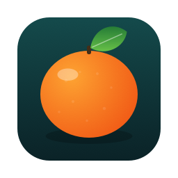
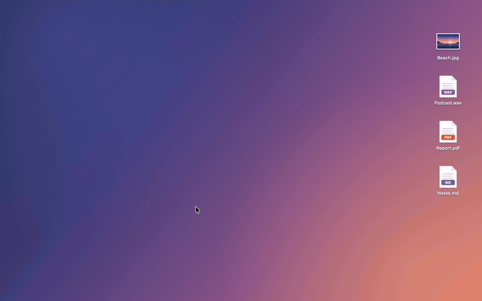
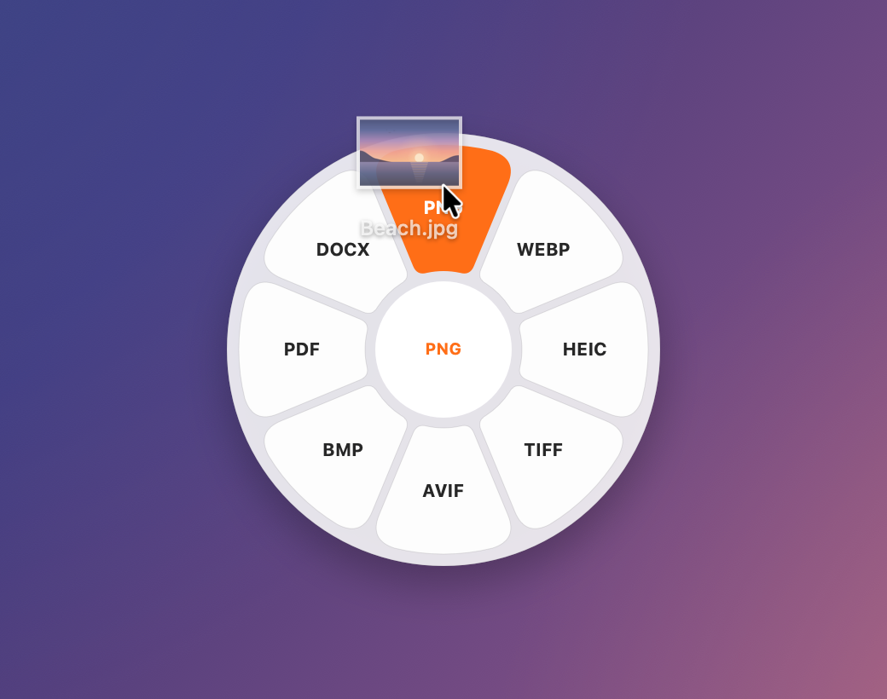
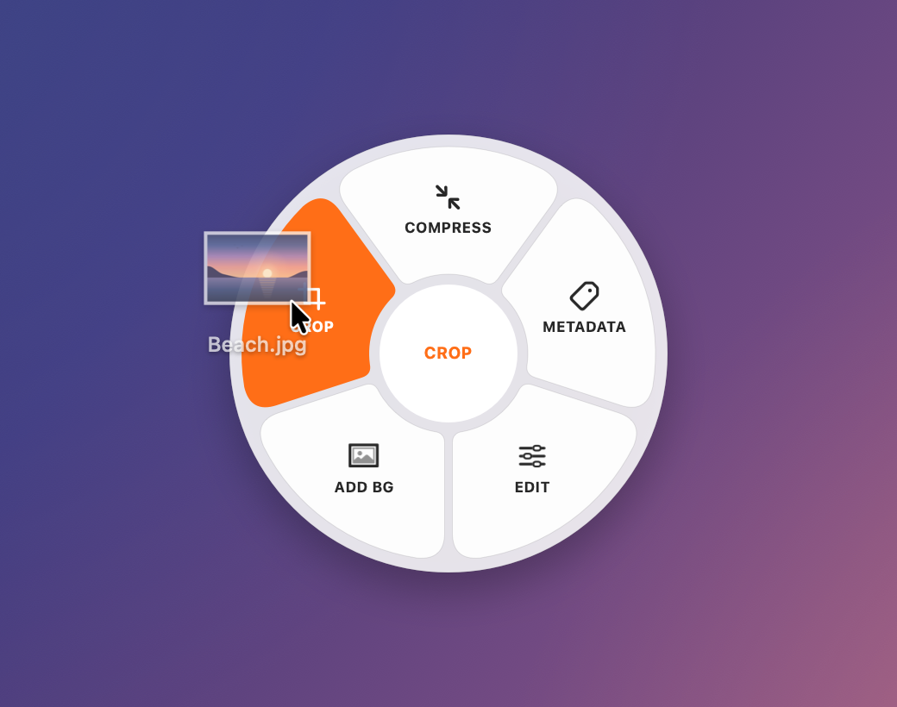
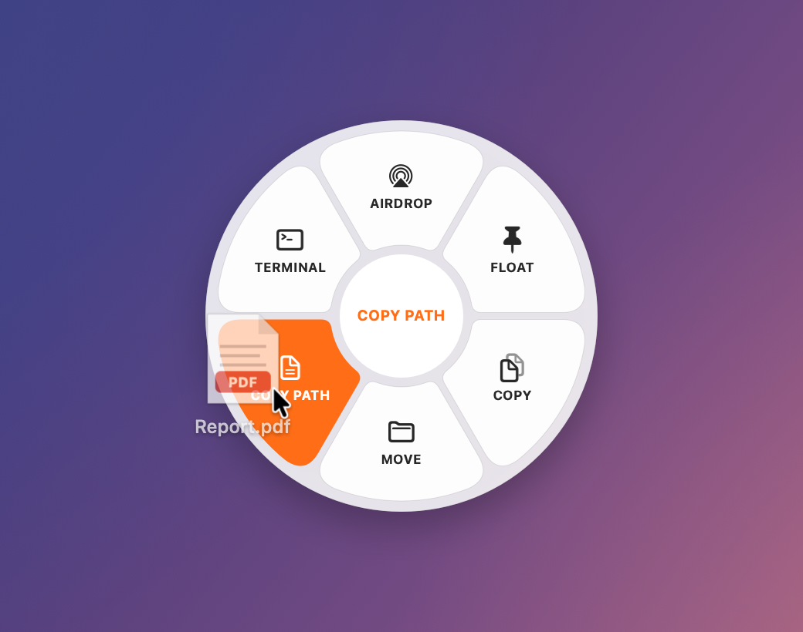
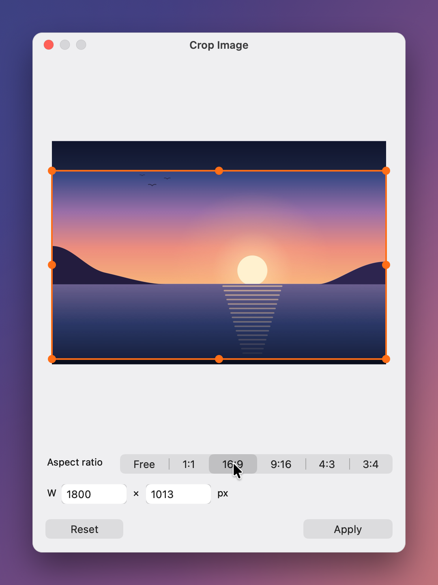
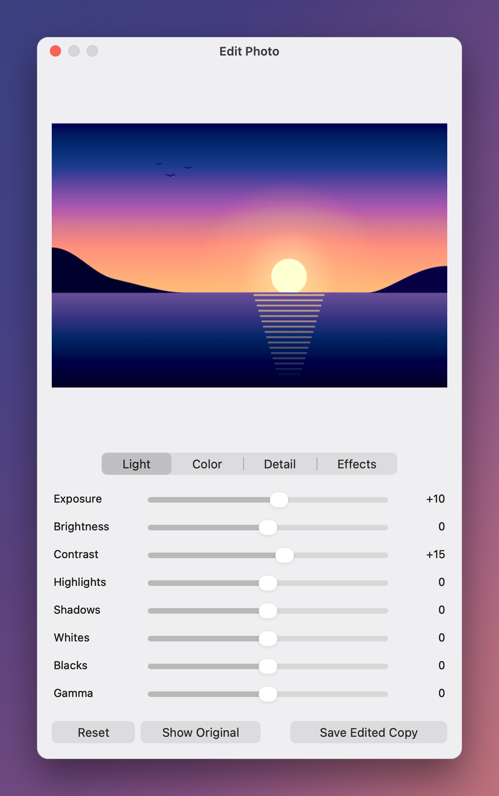
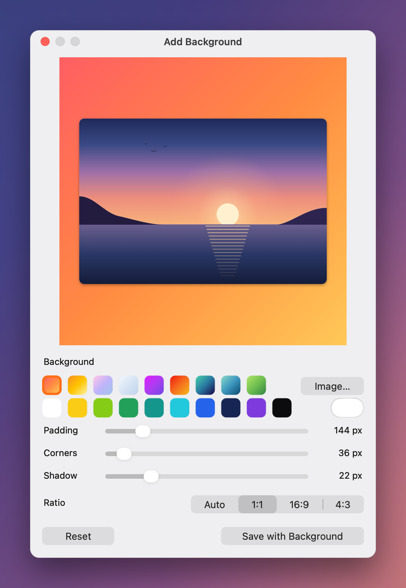

<p align="center">
  
</p>

<h1 align="center">Satsuma</h1>

<p align="center">A drag-gesture file converter for the macOS menu bar, written in Rust.</p>

<p align="center">
  
  <br>
  <sub><a href="docs/demo.mp4">Watch the demo as video (MP4)</a></sub>
</p>

Drag files, tap a key, and a wheel of options opens under the pointer. Drop onto a petal and the
result is saved next to the original. Everything runs on your Mac: nothing is uploaded.

Satsuma is an independent reimplementation of the workflow of
[Tangerine](https://tangerineformac.com). It was built from observed behavior only, with no
copied code or assets. [SPEC.md](SPEC.md) documents that behavior, the evidence behind it, and what this
version implements.

## How to use it

<table>
  <tr>
    <td width="50%"></td>
    <td width="50%"></td>
  </tr>
  <tr>
    <td><b>1. Drag a file and tap Shift.</b> The Convert wheel lists the formats this file can become. Drop on one and the result is saved next to the original.</td>
    <td><b>2. Tap Command for tools:</b> compress, remove metadata, edit, add a background, crop, split, merge and more.</td>
  </tr>
  <tr>
    <td></td>
    <td></td>
  </tr>
  <tr>
    <td><b>3. Tap Control for actions:</b> AirDrop, Float, Copy, Move, Copy Path and Terminal. Tap another key at any time to switch wheels, or drop in the centre to cancel.</td>
    <td><b>Crop Image</b> opens when you drop a photo on CROP: drag the handles, pick a preset or type an exact size.</td>
  </tr>
  <tr>
    <td></td>
    <td></td>
  </tr>
  <tr>
    <td><b>Edit Photo:</b> 20 adjustments across Light, Color, Detail and Effects, with a live preview and Show Original.</td>
    <td><b>Add Background:</b> gradients, colours or your own image, with padding, rounded corners, shadow and a ratio.</td>
  </tr>
</table>

Releasing the key keeps the wheel open, so you can take your time to aim. A small window shows
progress (`Converting to MP3 · 1 of 1 saved`), and its × cancels the job.

Without dragging, use **Convert Files…** in the menu bar. Arrow keys move around the wheel, Return
applies, Escape cancels, and Shift/Command/Control switch wheels.

## Install

You need macOS 13 or later.

### Download (Apple silicon)

1. Download `Satsuma-<version>-macos-arm64.zip` from the
   [latest release](https://github.com/sonatina-dream/satsuma/releases/latest) and double-click it to
   unzip.
2. Drag **Satsuma.app** into your **Applications** folder.
3. Open it. Satsuma isn't notarized by Apple, so the first time macOS stops it:
   - **macOS 15 Sequoia and later:** macOS says it couldn't verify Satsuma. Click **Done**, open
     **System Settings → Privacy & Security**, scroll to **Security**, click **Open Anyway** next to
     "Satsuma was blocked", and confirm with your password or Touch ID.
   - **macOS 13 and 14:** Control-click Satsuma in Applications, choose **Open**, then click **Open**.

   Or, in Terminal: `xattr -dr com.apple.quarantine /Applications/Satsuma.app`

   You only need to do this once.
4. Satsuma appears in the menu bar as a citrus slice. It has no Dock icon. Turn on **Launch at
   Login** in its menu to keep it running.
5. For audio and video, install [ffmpeg](https://ffmpeg.org). With [Homebrew](https://brew.sh):
   `brew install ffmpeg`. Images, documents, PDFs, spreadsheets, subtitles and archives work
   without it.

Satsuma needs no Accessibility or Screen Recording permission. It detects drags from the system drag
pasteboard and the mouse and modifier state.

### Build from source

Use this on Intel Macs, or to build the latest code. You need the Xcode Command Line Tools
(`xcode-select --install`) and Rust 1.80 or later from [rustup.rs](https://rustup.rs).

```sh
git clone https://github.com/sonatina-dream/satsuma.git
cd satsuma
./scripts/bundle.sh                     # builds dist/Satsuma.app (release, ad-hoc signed)
cp -R dist/Satsuma.app /Applications/
open /Applications/Satsuma.app
```

An app you build yourself isn't quarantined, so macOS opens it without the steps above.

### Update or uninstall

To update, quit Satsuma from its menu, replace the app in Applications with the new one and open it
again. To uninstall, quit it, delete `Satsuma.app` and, if you like, its settings folder
`~/Library/Application Support/Satsuma`.

## What it can do

- **Conversions**: all 283 paths of the original matrix (275 on its website plus Images → DOCX). 259 work
  today. The rest (Pages, PowerPoint, PDF→XLSX) are hidden. Run `satsuma formats` for the list on your Mac.
  - Images: JPG, PNG, WebP, HEIC, TIFF, AVIF, BMP, PDF, and DOCX via on-device text recognition (SVG input)
  - Audio: MP3, M4A, WAV, FLAC, OGG, Opus, AIFF, WMA
  - Video: MP4, MOV, MKV, WebM, AVI, WMV, plus GIF and MP3 export
  - Documents: DOCX, Markdown, TXT, RTF/RTFD, text clippings, EPUB, HTML, and PDF/PNG/JPG export
  - PDF: TXT, Markdown, DOCX, EPUB, and JPG/PNG pages at 300 DPI. Scanned PDFs are read with OCR
  - Spreadsheets: XLSX, XLS, ODS, CSV, TSV, and PDF export
  - Subtitles: SRT ⇄ VTT, and TXT export
  - Archives: ZIP, TAR, GZIP, and RAR input
- **Editors**: dropping a photo on EDIT, CROP or ADD BG opens a window with a live preview.
  - **Edit Photo**: 20 adjustments across Light, Color, Detail and Effects, plus Show Original.
  - **Crop Image**: handles; Free, 1:1, 16:9, 9:16, 4:3 and 3:4 presets; exact W×H.
  - **Add Background**: gradients, solids, your own image or colour; padding, corners, shadow; Auto, 1:1,
    16:9 and 4:3.
- **Tools**: Compress (images, audio, video, PDF), Remove Metadata (lossless for JPEG, PNG, WebP and GIF;
  keeps photo orientation), Normalize Volume, Trim Silence, Mono/Stereo, Audio Visualizer, Remove
  Audio, Speed 2×, Video Snapshot, Split Video, Join Videos, Split PDF, Merge PDFs, Create PDF,
  Collage, Extract Archive.
- **Actions**: AirDrop, Float (an always-on-top shelf you can drag files out of), Copy, Move, Copy
  Path, Terminal/iTerm2.

Results never overwrite anything: name clashes become `photo 2.jpg`, `photo 3.jpg` and so on. Each job
writes to a hidden temporary file first and renames it at the end, so a failure or a cancel leaves
nothing behind.

Settings (wheel keys, compression strength, image size, split parts, terminal app, Float
behavior, sound, launch at login) live in the menu-bar menu and are saved to
`~/Library/Application Support/Satsuma/settings.json`.

## Command line

The same binary works as a CLI (`/Applications/Satsuma.app/Contents/MacOS/Satsuma`, or
`target/release/satsuma` after a build):

```sh
satsuma formats                          # the conversion matrix and what works here
satsuma targets notes.md photo.heic      # what each wheel would offer
satsuma convert --to mp3 *.wav
satsuma tool compress clip.mov
satsuma tool mergePDF a.pdf b.pdf
satsuma tool editImage --set exposure=20 --set temperature=30 photo.jpg
satsuma tool cropImage --aspect 1:1 photo.jpg
satsuma tool frameImage --background sunset --ratio 1:1 photo.png
satsuma render-wheel --mode tools --format pdf --selected 0 --out wheel.png
```

## Development

```sh
cargo run -p satsuma-app                # start the menu-bar app from the terminal
SATSUMA_DEBUG=1 cargo run -p satsuma-app  # log gestures, events and jobs to stderr
cargo test --workspace
./scripts/bundle.sh                     # build dist/Satsuma.app
./scripts/record-demo.sh                # re-render docs/demo.* and docs/screenshots (needs ffmpeg)
```

The demo and screenshots are not screen recordings. `scripts/record-demo.sh` builds a hidden
`render-demo` command that draws a desktop with invented sample files and renders the app's own
wheel, progress and editor views into it.

| Crate | Role |
|-------|------|
| `crates/satsuma-core` | Platform-independent logic: formats, the 275-path matrix, tools and actions, output naming, wheel geometry and hit testing, the drag-gesture state machine, settings |
| `crates/satsuma-engine` | Conversion backends, job planning, staging and publishing results, progress and cancellation |
| `crates/satsuma-app` | AppKit app (objc2): status item, drag sampling, wheel panel (drop target), progress window, Float shelf, actions, CLI |

There are 68 core tests (matrix, naming, geometry, gesture state machine, crop, background and adjustment
models, settings) and 50 engine unit tests. There are also 17 end-to-end tests that run real conversions on
generated audio, video, images, documents, PDFs, spreadsheets, subtitles and archives. They include crop,
add background, edit photo, OCR to DOCX, scanned PDFs and cancellation cleanup. Media tests are skipped
when ffmpeg isn't installed.

## Not in this version

These Tangerine editors aren't built yet: Annotate, Redact (photo and video), Trim Video, Crop
Video, Organize PDF, Bleep Audio and QR reading. Tangerine also shows an options window before most
tools; Satsuma uses the defaults from its menu instead. Also missing: Pages and PowerPoint formats, and
metadata editing. See SPEC.md §12 for the full list.

## Support

If this app is useful to you, you can buy me a beer. Thank you! 🍺

[](https://buymeacoffee.com/sonatina_dream)

## License

[MIT](LICENSE)
